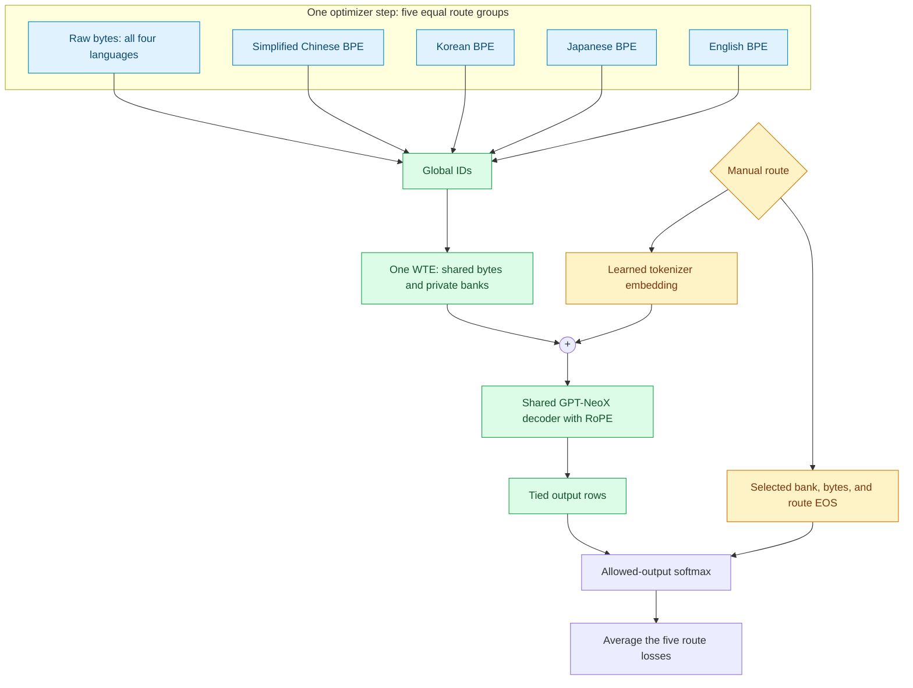

# Shared-byte mixture of tokenizers

A Hugging Face experiment with one causal transformer, five manual tokenizer routes, and a genuinely shared 256-byte vocabulary. The main sweep trains two models sequentially on one RTX 4090: **10,000** or **20,000 private text tokens per language**.

The four specialists are Simplified Chinese, Korean, Japanese, and English. Each effective optimizer batch contains five equal route groups: raw multilingual bytes plus one BPE group per language. The byte group cycles evenly through the four language corpora. The router is selected explicitly; only its input embedding is learned.

This folder is self-contained and can be placed at `huggingface_model/mixture_tokenizers/` inside ReaLLM-Forge. Long GPU training and real-corpus quality results must be measured on the target machine; synthetic smoke runs establish correctness, not language quality.

See [VALIDATION.md](VALIDATION.md) for the completed checks and their limits.

## Architecture



For token ID $z_t$ and fixed route $r$, the model input is

$$x_t=E[z_t]+T[r],\qquad T\in\mathbb R^{5\times d}.$$

The route embedding is added at every position, including shared bytes and cached generation steps. RoPE supplies position information separately. The model uses a single embedding parameter table; tied output projection selects rows from the same table. Training can project only the active route's rows to avoid allocating unused logits. Inference exposes global masked logits for HF generation.

Let $A_r$ contain the shared bytes, route $r$'s private lexical bank, and its EOS. Then

$$p(z_{t+1}=j\mid z_{\le t},r)=\operatorname{softmax}_{j\in A_r}(h_t^\top E_j).$$

Each route's cross entropy is normalized by its non-padding predicted targets. The training objective is the average of those five means, implemented by five accumulated route groups before one optimizer update.

## Vocabulary and text preservation

| Property | Contract |
| --- | --- |
| Route IDs | `byte=0`, `zh=1`, `ko=2`, `ja=3`, `en=4` |
| Shared byte IDs | `0–255`, exactly the UTF-8 byte values |
| Private banks | Four disjoint blocks of K text tokens, beginning at 256 |
| Digits | Each specialist owns ten native singleton tokens `0`–`9`; no digit merges |
| Controls | Private BOS, EOS, PAD for each of five routes |
| Global size | `256 + 4*K + 15`: **40,271** or **80,271** |
| Output restriction | Current lexical bank, all shared bytes, current EOS; no BOS/PAD predictions |

“Disjoint” concerns IDs and parameter rows, not geometric orthogonality. Chinese and Japanese may both contain `中` but assign distinct IDs. All specialists have private punctuation and digit IDs, while byte fallback uses the same shared rows. The byte route represents digits directly as ASCII bytes.

The tokenizer uses Unicode BPE rather than GPT-2 ByteLevel BPE. A candidate BPE is learned on each language's **training split only**, then script-invalid entries are pruned and valid merges replayed in rank order. Only merges whose operands already exist are retained. The first K reachable lexical entries form the exported tokenizer; 10k and 20k share the same candidate stream and initial alphabet. A too-small corpus fails with an explanation instead of silently adding dummy tokens.

| Specialist | Private text policy |
| --- | --- |
| Chinese | Han, selected punctuation, whitespace, singleton ASCII digits |
| Korean | Hangul/Jamo, selected punctuation, whitespace, singleton ASCII digits |
| Japanese | Han, Hiragana, Katakana and relevant kana marks, selected punctuation, whitespace, digits |
| English | Latin script and applicable marks, selected punctuation, whitespace, digits |

Regex constrains private vocabulary strings; it does not delete corpus text or prevent fallback bytes from spelling another language. Korean Hanja and embedded Latin text in CJK routes use fallback unless represented by the route's policy. Chinese and Japanese Han cannot be distinguished by script regex alone.

**Simplified Chinese conversion is an explicit preparation step:** `zh_conversion: t2s` applies OpenCC to Chinese source documents before deduplication/splitting. The prepared text is the experimental source of truth. Tokenizer inference does not convert, lowercase, normalize Unicode, or discard whitespace. Encoding valid Unicode round-trips exactly; decoding concatenates token byte payloads before UTF-8 conversion. Generation can emit invalid UTF-8 byte sequences, which should be measured separately.

## Setup

Use Python 3.10–3.12. CUDA mode installs the PyTorch 2.5.1 CUDA 12.4 wheel; the system NVIDIA driver must support that wheel. A separate CUDA toolkit installation is not required for these prebuilt wheels.

```bash
cd huggingface_model/mixture_tokenizers
bash setup.sh --cuda
source .venv/bin/activate
python -m pytest -q
```

For a CPU machine, use `bash setup.sh --cpu`. `--python python3.12` and `--venv /path/to/venv` are optional. Do not install torchvision; it is unnecessary for this text experiment.

## CPU smoke run

The demo contains synthetic multilingual text and uses a small 128-token private bank. It requires no corpus download.

```bash
python prepare_data.py --config configs/smoke.yaml --demo
python train_tokenizers.py \
  --data data/demo --output tokenizers/demo \
  --sizes 128 --alphabet-limit 96 --candidate-size 4096
python run_sweep.py --config configs/smoke.yaml
python evaluate.py \
  --model runs/demo/k128/checkpoint-best \
  --data data/demo --split val --context-mode bytes \
  --max-documents 10 --device cpu --output runs/demo/k128/evaluation.json
python generate.py \
  --model runs/demo/k128/checkpoint-best \
  --route zh --prompt '今天的天气' --max-new-tokens 32 --temperature 0
```

Generation from this smoke checkpoint is a functionality check, not a useful trained language model.

## Prepare the real experiment

`configs/4090.yaml` uses bounded streaming samples, not complete web-corpus downloads:

| Language | Source | Subset |
| --- | --- | --- |
| Simplified Chinese | [FineWeb2](https://huggingface.co/datasets/HuggingFaceFW/fineweb-2), followed by explicit OpenCC t2s | `cmn_Hani` |
| Korean | FineWeb2 | `kor_Hang` |
| Japanese | FineWeb2 | `jpn_Jpan` |
| English | [FineWeb](https://huggingface.co/datasets/HuggingFaceFW/fineweb) | `sample-10BT` |

These sources are configurable defaults. FineWeb2's Han subset is not assumed to be already Simplified Chinese. The preparation manifest records resolved dataset revisions, conversion policy, document hashes, and byte counts. Keep this manifest with results. The default cap is 200,000 accepted documents or 500 MB of prepared UTF-8 text per language, with 1% validation and 1% test splits. Tokenization caches and Hugging Face downloads require additional disk space.

The configuration pins FineWeb2 to `af9c13333eb981300149d5ca60a8e9d659b276b9` and FineWeb to `9bb295ddab0e05d785b879661af7260fed5140fc`. Preparation expects a new/empty output directory so existing splits are not silently replaced. For local corpora, set `data.source: local` and provide `data.local_files` with `zh`, `ko`, `ja`, and `en` paths. Prefer JSONL/NDJSON with one `{"text": "..."}` object per document; other suffixes treat each physical line as a document and retain its newline.

```bash
python prepare_data.py --config configs/4090.yaml
python train_tokenizers.py \
  --data data/prepared --output tokenizers \
  --sizes 10000 20000 --alphabet-limit 4000 \
  --candidate-size 60000 --min-frequency 2
```

Do not train tokenizers on validation or benchmark text. Preparation removes exact duplicates; it is not a guarantee against all near-duplicate benchmark contamination. Preserve source attribution and applicable dataset terms when sharing results; do not bundle downloaded corpus files with the code.

## Train the 4090 sweep

The default backbone has 6 layers, width 384, 6 heads, FFN width 1536, and context 512. It uses BF16, SDPA, AdamW, and tied embedding/output weights. Four sequences per route yield 20 sequences per optimizer step. Each byte group includes one sequence from each language.

```bash
python run_sweep.py --config configs/4090.yaml --dry-run
python run_sweep.py --config configs/4090.yaml --evaluate
```

The runner completes 10k, then 20k, on the same GPU. It resumes existing `checkpoint-last` directories automatically. Restart the same command after interruption. Errors stop the sweep; a failed first run does not silently launch the next one. Run directories are `runs/k10000` and `runs/k20000`.

The 20M-token pilot budget counts non-padding predicted text and genuine EOS targets; BOS and padding do not count. Route balancing does not imply equal source-byte exposure: log and compare both. The 20k variant adds 15.36M embedding parameters at width 384, so this is a backbone-matched comparison.

For fresh 100M-token runs, retain the same prepared corpora and tokenizers and use a new output root:

```bash
python run_sweep.py --config configs/4090.yaml \
  --target-tokens 100000000 --output-root runs/100m --evaluate
```

To extend the existing pilots instead:

```bash
python run_sweep.py --config configs/4090.yaml --target-tokens 100000000 --evaluate
```

`--target-tokens` and `--max-steps` are **total** limits including resumed work. Increasing the target changes the cosine decay horizon and can raise the learning rate relative to the end of the pilot; the resumed run is not equivalent to a fresh 100M-token schedule. Use a new output root for a clean controlled schedule. Token budgets can be exceeded by the final complete optimizer step so all five groups remain balanced.

To run just one condition:

```bash
python run_sweep.py --config configs/4090.yaml --sizes 20000
```

Inspect the Rich progress display, per-step JSONL logs, run `summary.json`, and parent `sweep-summary.json`. Checkpoints contain HF model files, the tokenizer bundle in `tokenizer/`, and training state. Quick validation reports per-route token NLL for monitoring a run; standalone evaluation supplies comparable BPB.

## Evaluate tokenizer effects

Score identical validation documents under the native and byte routes:

```bash
python evaluate.py \
  --model runs/k10000/checkpoint-best --data data/prepared \
  --split val --context-mode bytes --max-documents 100 \
  --device cuda --output runs/k10000/val-matched-text.json
python evaluate.py \
  --model runs/k20000/checkpoint-best --data data/prepared \
  --split val --context-mode bytes --max-documents 100 \
  --device cuda --output runs/k20000/val-matched-text.json
```

Repeat with `--context-mode token` to compare the practical effect of a fixed token window. Byte-context mode chooses identical raw-text chunks that fit the byte route; each chunk starts a fresh context, so it controls text exposure while changing context-reset behavior. Token-context mode scores every target once with bounded token windows. EOS loss is reported separately from text BPB.

$$\mathrm{BPB}=\frac{\sum_t-\log p(z_t\mid z_{<t},r)}{N_{\text{UTF-8 bytes}}\log2}.$$

This is a deterministic-tokenization coding rate. Multiple token sequences can decode to the same string, so it is not a marginalized text likelihood. Do not compare raw token perplexities across tokenizers. Report per-language values and an equal-language macro-average, along with source bytes, characters, fallback rates, parameter counts, GPU time, and peak VRAM.

Use the validation split for choices and the test split once settings are frozen. The first language benchmarks are listed in `configs/benchmarks.yaml`:

| Language | Initial tasks | Later tasks |
| --- | --- | --- |
| Chinese | C-Eval validation | CMMLU |
| Korean | KoBEST COPA and BoolQ | KMMLU |
| Japanese | JGLUE JCommonsenseQA | JSQuAD |
| English | HellaSwag validation, ARC-Easy | ARC-Challenge |
| Parallel comparison | Belebele `zho_Hans`, `kor_Hang`, `jpn_Jpan`, `eng_Latn` | Full selected splits and repeated seeds |

`evaluate.py --mc-jsonl` accepts prepared multiple-choice records with `language`, `prompt`, `choices`, and `answer_index`. It scores boundary-fixed prompt/continuation encodings by summed conditional log probability. This generic protocol is not an automatic reproduction of official benchmark templates or scoring; freeze and document those adapters before publishing official comparisons. Preserve acronyms, symbols, and foreign names for fallback handling. Small models may remain near chance on knowledge benchmarks even when held-out BPB improves.

## Files and integration

| File | Role |
| --- | --- |
| `prepare_data.py`, `data_pipeline.py` | Bounded ingestion, explicit Chinese conversion, document splits, cached windows, balanced byte sampling |
| `train_tokenizers.py`, `tokenization_mixture.py` | HF Unicode BPE training/pruning, disjoint global mapping, lossless decode |
| `configuration_mixture.py`, `modeling_mixture.py` | HF configuration/model, route embedding, shared tied weights, routed output, cached generation |
| `train.py`, `run_sweep.py` | Balanced training, checkpoint/resume, sequential sweeps |
| `evaluate.py`, `generate.py` | BPB, local multiple-choice scoring, manual-route generation |
| `tests/` | Text round trips, digit IDs, sharing, masks, loss weighting, caching, serialization, data boundaries |

The model uses HF APIs with a small custom training loop so five route means receive exactly equal optimizer-step weight. Tokenizers use Rust-backed HF BPE engines behind a route-aware `PreTrainedTokenizer` wrapper. Save/reload is through the provided classes; importing the model module registers its local Auto classes where supported.

ReaLLM-Forge's [multidataset code](https://github.com/ReaLLMASIC/ReaLLM-Forge/blob/d090ae123a02b5389d066b9b821f87ac0ae3a8e8/model.py) and [OneHotLSV](https://github.com/ReaLLMASIC/ReaLLM-Forge/blob/d090ae123a02b5389d066b9b821f87ac0ae3a8e8/variations/lsv_variations.py) motivated the shared-backbone/manual-vector design. This implementation shares actual byte rows across routes and uses ranked HF BPE merges; it does not reproduce the original character-BPE longest-prefix encoder bit for bit.

HF references: [BPE model API](https://huggingface.co/docs/tokenizers/v0.20.3/en/api/models), [custom models](https://huggingface.co/docs/transformers/custom_models), [GPT-NeoX](https://huggingface.co/docs/transformers/model_doc/gpt_neox).
