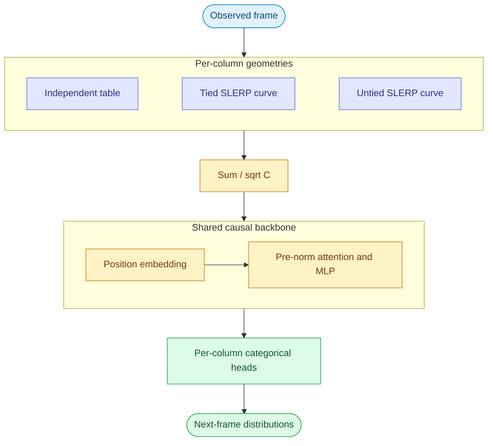

# Stream Lane Lab

A compact experiment repo for forecasting numeric streams with small causal transformers. Each data column chooses its own independent embedding table or linked SLERP curve, and chooses whether to share its input geometry with its output head. The live viewer compares real model forecasts with incoming superimposed sine waves.

The first milestone is CPU inference on one, two, then three channels. GPU runs use the same geometry and optionally accelerate gather/blend operations with Triton. **CPU results do not validate CUDA kernels or establish a Triton speedup.**

See [measured CPU results](examples/RESULTS.md) for the bundled checkpoints, latency, and horizon-dependent errors.

## Start with the bundled checkpoints

Copy this folder into an existing repository, or use it on its own. No Git initialization, Node build, model download, or external data service is required.

```bash
cd stream-lane-lab
bash setup.sh --cpu
source .venv/bin/activate
python -m lane_lab serve --runs examples/checkpoints --port 8765
```

Open **http://127.0.0.1:8765**. Select a checkpoint, change the sine seed, and compare predictions with actual values as they arrive. The viewer starts at an eight-sample horizon; increase it to inspect free-running drift. The future truth is available to the synthetic demo for visualization; only the observed history is submitted to the model. The viewer measures inference latency and errors from earlier forecasts once their targets become observable.

For CUDA, preserve a CUDA-enabled PyTorch installation in the selected virtual environment, or set `TORCH_INDEX_URL` to a CUDA wheel index from the [PyTorch installation selector](https://pytorch.org/get-started/locally/) and run `bash setup.sh --cuda`. Linux CUDA PyTorch normally installs its compatible Triton dependency. `--dev` adds the test dependencies.

## Reproduce the experiments

```bash
# One column; learned, linked five-knot input and tied output curve.
python -m lane_lab train --channels 1 --variant slerp --knots 5 \
  --tied --steps 1500 --output runs/one-channel

# Gradually increase dimensionality using the same experiment driver.
python -m lane_lab sweep --channels 1 2 3 --steps 1500 --output runs/sine

# Inspect held-out prediction and free-running behavior.
python -m lane_lab evaluate --model runs/one-channel/best \
  --output runs/one-channel/evaluation
python -m lane_lab report --runs runs/sine --output runs/sine/report
python -m lane_lab serve --runs runs/sine --port 8765
```

Run `python -m lane_lab COMMAND --help` for all options. Training writes machine-readable configuration, step logs, validation metrics, and Hugging Face checkpoints. Do not compare a training-batch loss with a held-out rollout score.

The full sweep is **27 runs**: nine variants for each of three channel counts. It includes the tied independent baseline and tied/untied SLERP at 2, 3, 5, and 9 knots. For a quick start, run the single-model command first. Independent untied is also supported with `--variant independent --no-tied`. Sweep restarts skip completed runs; use a fresh output directory to change settings. Incomplete training is not automatically resumed. For a new fine-tuning stage, `train --init-model PATH --output NEW_DIRECTORY` loads the checkpoint configuration and weights with a fresh optimizer; this is not an optimizer-state resume. Geometry/size flags are ignored in that mode, and `--config` cannot be combined with it.

Fresh runs record `initialization_protocol: matched-v1`: for the same channel count, backbone dimensions, training seed, and batch settings, variants start from identical backbone weights and receive identical minibatches and noise. Separate RNGs isolate geometry initialization from the backbone and data streams. Different input geometries remain intentional differences. Earlier exploratory runs without this marker are not matched comparisons.

A candidate with more direct supervision of numeric means and longer differentiable feedback is:

```bash
python -m lane_lab train --channels 1 --variant slerp --knots 5 --tied \
  --steps 2500 --target-mode linear --input-noise 0 \
  --rollout-steps 8 --rollout-gradient full --output runs/c1-linear-full
```

Repeat with `--channels 2` and `--channels 3` using new output directories. This is a reproducible candidate configuration; consult measured results before treating it as an improvement. Training options and objective settings are recorded in `run.json`.

The sine benchmark sums several fixed-frequency sinusoids in each column, with seed-dependent amplitudes and phases. Different seeds define training and held-out examples. Values stay inside `[-1, 1]`; no file downloads are needed. This tests interpolation across phases and amplitudes within a known frequency family, **not arbitrary-frequency or real-world generalization**. Evaluation compares the transformer against persistence and includes horizons longer than one step.

## Choose geometry per column

The names `triton_independent` and `triton_slerp_independent` describe combinations of two separate settings: mathematical `kind` and execution `backend`. Keeping them separate makes CPU/GPU comparisons use the same model.

| Configuration | Input embedding | Output head |
| --- | --- | --- |
| `independent`, `tied: true` | Free vector for every level | Same table |
| `independent`, `tied: false` | Free vector for every level | Separate free table |
| `slerp`, `tied: true` | Spherical curve through `K` linked knots | Same curve |
| `slerp`, `tied: false` | Spherical curve through `K` linked knots | Free output knots and independent learned interpolation angles |

`K=2,3,5,9` means **knots**, giving `1,2,4,8` connected segments. An internal knot is shared by its neighboring segments. This sharing is independent of input/output tying. Untied SLERP changes both weight sharing and output constraints, so it is not a pure tying ablation.

For example, `configs/mixed.json` selects an independent lane, a tied five-knot lane, and an untied three-knot lane. Use `--config configs/mixed.json` with `train`. The synthetic training CLI assumes `[-1,1]` ranges for every column; custom physical ranges are supported by the model and streaming API, but need a corresponding data pipeline. Every column declares its name, level count, numeric range, and `backend`:

| Backend | Behavior |
| --- | --- |
| `torch` | PyTorch reference on CPU or CUDA |
| `auto` | Triton on supported CUDA inputs when available; PyTorch otherwise |
| `triton` | Requires supported CUDA/Triton execution; errors rather than silently falling back |

Independent output projections and knot projections use PyTorch matrix multiplication; causal attention uses PyTorch SDPA. The implementation does not claim that the entire transformer is a custom Triton kernel.

## Model and training contract

One timestamp becomes one transformer token. The per-column vectors are summed and divided by `sqrt(C)`, then combined with a learned position embedding. Pre-norm RMSNorm, causal attention, and a ReLU² MLP produce a hidden state used by every column head. All heads predict the next timestamp simultaneously. CLI defaults use width 48, two layers, two attention heads, MLP width 144, and context 64.



The forward API takes `values: [batch,time,columns]` and already-aligned integer labels. Shift exactly once:

```python
import torch
from lane_lab import LaneConfig, LaneModel

model = LaneModel(LaneConfig(columns=[
    dict(name="signal", kind="slerp", knots=5, tied=True,
         levels=128, minimum=-1.0, maximum=1.0, backend="auto")
]))
series = torch.rand(2, 65, 1) * 2 - 1
inputs, targets = series[:, :-1], series[:, 1:]
result = model(inputs, labels=model.quantize(targets), target_values=targets)
result.loss.backward()
model.save_pretrained("runs/example")
restored = LaneModel.from_pretrained("runs/example")
prediction = restored.forecast(inputs, horizon=16, mode="mean")
```

Importing `lane_lab` also registers the config/model with Hugging Face Auto classes. The model does not use a text tokenizer or language-model `.generate()` contract: `forecast()` explicitly manages numeric columns and their different level counts.

Cross-entropy is averaged equally across columns. **The training CLI defaults to a forecasting objective, not pure cross-entropy:** CE + 10 × expected-value MSE, input noise of standard deviation 0.004, and a four-step rollout MSE term with weight 10 every fourth update after the first quarter of training. Generated feedback is detached between rollout steps; this teaches recovery without backpropagating through the full trajectory. Use `--mse-weight 0 --rollout-weight 0 --rollout-steps 0 --input-noise 0` for a pure-CE ablation. Record the objective alongside any variant comparison.

`--target-mode hard` (default) uses the nearest quantization level. `--target-mode linear` distributes target mass only between the two neighboring levels, with weights chosen so their expected numeric value equals the in-range target exactly. This is interpolation between adjacent bins, not uniform label smoothing. **Evaluation `teacher_nll` always uses hard quantization**, including models trained with linear targets.

`--rollout-gradient detached` is the default. `--rollout-gradient full` retains the feedback computation graph, allowing gradients through continuous SLERP inputs. Independent input tables still round to integer indices, so that quantizer blocks gradients through generated scalar values even in `full` mode. Each rollout prediction still has its own supervised loss in either mode.

The model API separately supports `auxiliary_mse_weight`, defaulting to zero. CLI experiments calculate their configured loss explicitly, so the example API call and the CLI defaults have different objectives. `mean` decoding returns the categorical expectation, `greedy` picks the highest-probability level, and `sample` draws a level. These modes have different rollout behavior; NLL alone does not select the best streaming decoder.

## Streaming and verification

The local server provides `GET /api/models`, `GET /api/signal`, and `POST /api/forecast`. A forecast request contains a model ID, observed `history`, `horizon`, and decoding options. It can therefore accept externally collected numeric streams instead of the sine generator. Preserve column order, declared value ranges, and sampling interval. This version does not learn irregular-time dynamics or handle missing data automatically.

```bash
bash setup.sh --cpu --dev
source .venv/bin/activate
python -m pytest
# On the GPU machine, run the same suite: CUDA parity cases execute there.
```

Tests cover geometry, tied/untied behavior, causal prediction, checkpoint round trips, and reference/kernel equivalence where supported. CUDA tests skip on CPU. See the bundled results for the exact environment and measured validation scope.

The first version recomputes the rolling context for every generated step. It has no KV cache: this keeps sliding-window position handling explicit and the reference easy to audit. Benchmark latency on your machine before increasing channel count, context, or horizon. A later cached implementation needs parity checks against this reference, especially when the context window rolls over.

## Files and further reading

| Location | Responsibility |
| --- | --- |
| `lane_lab/config.py`, `model.py` | Hugging Face config, causal transformer, forecasting |
| `lane_lab/geometry.py`, `kernels.py` | Per-column geometry and accelerated primitives |
| `lane_lab/data.py` | Reproducible sine streams |
| `lane_lab/experiment.py`, `__main__.py` | Training, evaluation, reports, CLI |
| `lane_lab/server.py`, `static/index.html` | Local API and live viewer |
| `configs/` | Editable mixed-column configuration |
| `examples/` | Bundled checkpoints and measured results |
| `tests/` | Correctness and optional CUDA parity checks |

[Technique derivations](docs/techniques.md) explain quantization, spherical versus relaxed geometry, gradients, parameter counts, and free-running evaluation. View the rendered [architecture](docs/architecture.svg) and [linked geometry](docs/geometry.svg) diagrams; their editable sources are in `docs/*.mmd`. API references: [Hugging Face custom models](https://huggingface.co/docs/transformers/en/custom_models), [Triton tutorials](https://triton-lang.org/main/getting-started/tutorials/).
